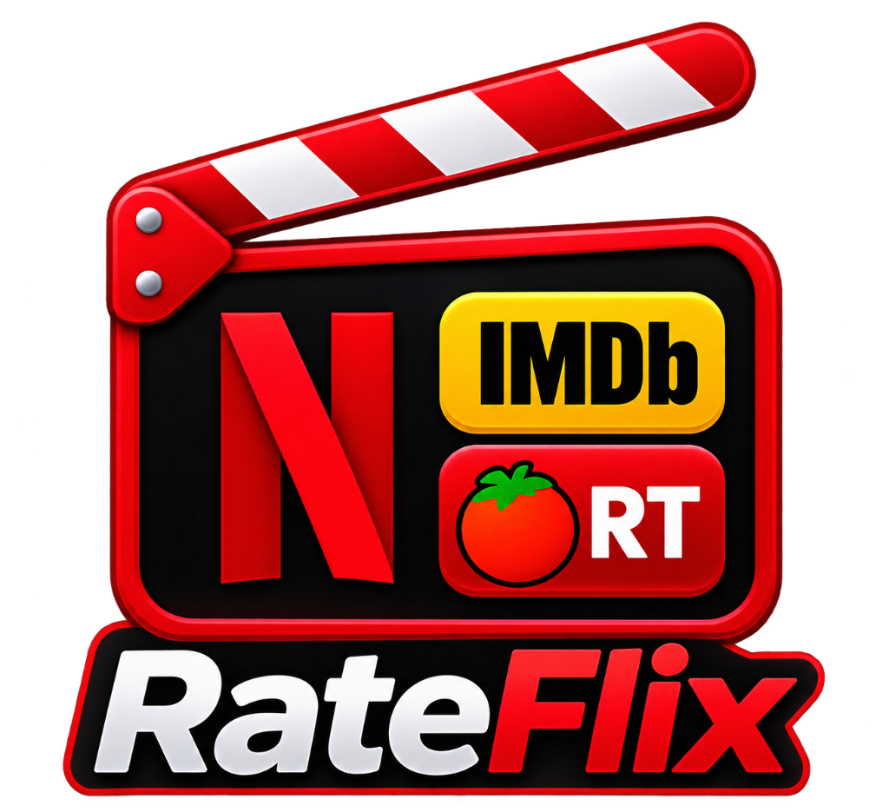
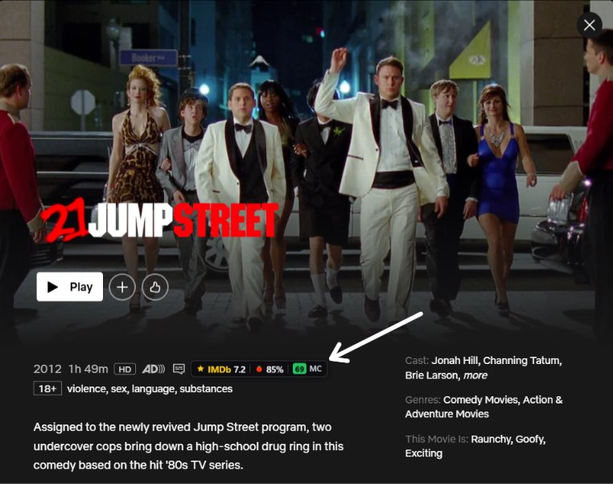
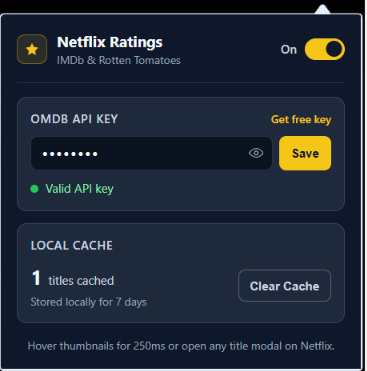

<div align="center">
  

  # RateFlix

  **IMDb, Rotten Tomatoes & Metacritic ratings injected directly into the Netflix web interface.**

  Built with Vanilla JavaScript, HTML, and CSS using **Chromium Manifest V3**, compatible with **Opera**, **Opera GX**, **Google Chrome**, **Microsoft Edge**, and **Brave**.

  [English Guide](#preview) | [الشرح التفصيلي بالعربية](#النسخة-العربية)
</div>

---

## Preview

### Netflix Detail & Preview Modal Badge
Displays IMDb score (with direct clickable link to IMDb), Rotten Tomatoes Tomatometer score, and Metacritic Metascore directly inside Netflix's metadata row:



### Extension Settings Popup
Dark-mode settings panel styled in the RateFlix cinema palette to configure and validate your OMDb API key, customize badge placement and visible rating sources, monitor daily API quota status, and manage the 7-day local cache:



---

## Features

- **IMDb, Rotten Tomatoes & Metacritic Scores**:
  - Fetches `imdbRating`, `imdbID` (clickable IMDb link), Rotten Tomatoes score from `Ratings`, and `Metascore` (color-coded green `>= 61`, amber `40-60`, red `< 40`) in a single OMDb request with zero extra network overhead.
- **Hover & Modal Support with Smooth Fade-In**:
  - Floating badge on Netflix thumbnail cards (`top-left` or `top-right`) with a smooth `180ms` GPU-accelerated fade-in animation (respecting `prefers-reduced-motion`).
  - Inline pill badge inside Netflix mini-modals and expanded detail modals.
- **Live Badge Customization**:
  - Switch thumbnail badge position between **Top Left** and **Top Right** directly from the popup.
  - Toggle **IMDb**, **Rotten Tomatoes**, and **Metacritic** individually on or off with instant live updates on open Netflix tabs.
- **API Rate-Limit & Daily Quota Protection**:
  - Does **not** fetch ratings for all visible thumbnails on page load.
  - Thumbnail requests fire only after hovering (`mouseenter`) for **250ms** (canceled automatically if `mouseleave` occurs earlier).
  - Detects when OMDb's free **1,000 requests/day** limit is reached and displays a clear warning banner inside the popup while continuing to serve cached titles.
- **Smart Title Cleaning & Fallback**:
  - Strips Netflix noise prefixes/suffixes (e.g., `Watch `, `(Limited Series)`, `- Season X`, trailing colons) before querying OMDb.
  - Queries with `title + year` when a 4-digit release year is available, and automatically falls back to `title`-only if the year lookup fails or returns `Response: "False"`.
- **Two-Layer 7-Day Cache**:
  - In-memory `Map` + persistent `chrome.storage.local` cache keyed by normalized title with a 7-day TTL, plus in-flight request deduplication.
- **Opera GX "Force Dark Pages" Protection**:
  - Uses `color-scheme: dark only;`, `-webkit-print-color-adjust: exact;`, and `forced-color-adjust: none;` so browser dark-mode overrides do not invert badge colors.
- **Safe Playback Interaction**:
  - Clicking the IMDb badge opens the title's IMDb page in a new tab with `e.stopPropagation()` so it never triggers Netflix video playback.

---

## How It Works (Architecture)

1. **`manifest.json`**
   Declares a clean Manifest V3 configuration with custom extension icons (`16px`, `32px`, `48px`, `128px`), requiring only `storage` permission and host access for `https://*.netflix.com/*` and `https://www.omdbapi.com/*`.

2. **`content.js` (DOM Observer, Live Preferences & Badge Injection)**
   - Uses stable attributes and structural selectors (`.slider-item`, `.title-card-container`, `[data-uia="title-card"]`, `a[aria-label]`, `.previewModal--wrapper`, `[data-uia="mini-modal"]`, `.previewModal--detailsMetadata`, `[data-uia="video-metadata"]`) rather than obfuscated Netflix CSS hashes.
   - Attaches `mouseenter` / `mouseleave` listeners with a 250ms debounce timer on thumbnail cards.
   - Runs a `MutationObserver` on `document.body` (`childList: true, subtree: true`) to detect opened mini-modals and detail modals, extract the cleaned title and release year, and inject the rating badge immediately.
   - Listens to `chrome.storage.onChanged` to immediately re-render injected badges when position or source visibility settings change in the popup.

3. **`background.js` (Service Worker, Quota Monitor & OMDb Integration)**
   - Listens for `GET_RATINGS`, `VALIDATE_API_KEY`, `GET_CACHE_STATS`, and `CLEAR_CACHE` messages via `chrome.runtime.onMessage`.
   - Resolves cached entries from `memoryCache` first, then `chrome.storage.local` (pruning entries older than 7 days), and deduplicates simultaneous requests for the same title.
   - Queries `https://www.omdbapi.com/?t={title}&y={year}&apikey={apiKey}` with automatic fallback to `https://www.omdbapi.com/?t={title}&apikey={apiKey}`, and tracks OMDb daily quota exhaustion (`Request limit reached!`).

4. **`styles.css`**
   - Styles the dark translucent badge (`rgba(12, 12, 16, 0.90)` with `backdrop-filter: blur(6px)`), smooth `180ms` fade-in animation, IMDb gold accent (`#F5C518`), Rotten Tomatoes indicator (`#FA320A` for `>= 60%`, `#22C55E` for `< 60%`), and color-coded Metacritic Metascore box.

5. **`popup.html` & `popup.js`**
   - Styled in the RateFlix cinema palette (`#0b0b0f` obsidian, `#14141b` slate, `#E50914` crimson, `#F5C518` gold).
   - Stores your OMDb API key, global enable/disable toggle, thumbnail badge position, and active rating sources in `chrome.storage.local`.
   - Alerts you clearly if the 1,000/day free OMDb quota is reached.

---

## Installation & Setup

### Step 1: Download the Repository
Clone or download this repository to your computer:

```bash
git clone https://github.com/evile92/RateFlix.git
```

*(Or click **Code -> Download ZIP** on GitHub and extract the folder.)*

### Step 2: Load the Extension in Your Browser

#### Opera / Opera GX
1. Open `opera://extensions` in the address bar.
2. Enable **Developer mode** (top-right toggle).
3. Click **Load unpacked** and select the downloaded `RateFlix` folder.
4. Pin the extension from the toolbar **Extensions** menu.

#### Google Chrome / Edge / Brave
1. Open `chrome://extensions` (or `edge://extensions` / `brave://extensions`).
2. Enable **Developer mode** (top-right toggle).
3. Click **Load unpacked** and select the downloaded `RateFlix` folder.

### Step 3: Add Your Free OMDb API Key
1. Click the **RateFlix** clapperboard icon in your browser toolbar.
2. Click **Get free key** (or visit [omdbapi.com/apikey.aspx](https://www.omdbapi.com/apikey.aspx)).
3. Select **FREE! (1,000 daily limit)**, enter your email and a short usage description, then submit.
4. **Open your email and click the activation link** from OMDb so the key becomes active.
5. Paste the API key into the extension popup and click **Save** — you should see a green **Valid API key** indicator.
6. Open or refresh `netflix.com`, hover over any title for 250ms, or click any title to open its modal.

---

## Project Structure

```text
RateFlix/
├── assets/
│   ├── logo.png
│   ├── preview-netflix-modal.jpg
│   └── preview-popup-settings.png
├── icons/
│   ├── icon16.png
│   ├── icon32.png
│   ├── icon48.png
│   └── icon128.png
├── manifest.json
├── background.js
├── content.js
├── styles.css
├── popup.html
├── popup.js
├── .gitignore
└── README.md
```

---

## النسخة العربية

### نبذة عن أداة RateFlix

أداة خفيفة للمتصفح تعرض تقييمات **IMDb** و **Rotten Tomatoes** و **Metacritic** مباشرة داخل واجهة موقع **Netflix** (على الصور المصغرة وداخل نوافذ التفاصيل)، وتعمل على **Opera** و **Opera GX** و **Google Chrome** و **Edge** و **Brave**.

---

### أبرز المميزات

1. **ثلاثة تقييمات في طلب واحد (IMDb + Rotten Tomatoes + Metacritic)**:
   - تستخرج الأداة تقييم IMDb (مع رابط مباشر لصفحة الفيلم) وتقييم Rotten Tomatoes وتقييم Metacritic الملون من نفس طلب OMDb دون أي استهلاك إضافي للشبكة.
2. **حركة ظهور ناعمة للشارة (Fade-in Animation)**:
   - تظهر شارة التقييم بانتقال بصري انسيابي (`180ms`) يجعلها تبدو جزءاً أصلياً من واجهة Netflix.
3. **تخصيص مباشر من نافذة الإعدادات (Popup)**:
   - إمكانية تغيير مكان الشارة على البطاقات المصغرة (**أعلى اليسار Top Left** أو **أعلى اليمين Top Right**).
   - إمكانية تفعيل أو إخفاء أي مصدر تقييم (**IMDb** أو **Rotten Tomatoes** أو **Metacritic**) مع تحديث فوري داخل صفحة Netflix المفتوحة.
4. **تنبيه واضح عند استهلاك الحد اليومي (1,000 طلب)**:
   - في حال وصول المفتاح المجاني إلى الحد الأقصى اليومي (1,000 طلب)، يظهر شريط تنبيه واضح داخل نافذة الإضافة مع استمرار عمل جميع الأفلام المحفوظة مسبقاً في الكاش.
5. **خفّة الأداء والتخزين المؤقت لمدة 7 أيام**:
   - لا يتم جلب التقييمات عشوائياً عند فتح الصفحة، بل فقط عند تمرير المؤشر لمدة `250ms` أو فتح نافذة التفاصيل، ويُحفظ كل عنوان محلياً لمدة 7 أيام.

---

### طريقة التثبيت أو التحديث

* **في Opera / Opera GX**: افتح `opera://extensions` ← فعّل **Developer mode** ← اضغط **Load unpacked** واختر مجلد المشروع (أو اضغط زر **Reload** إذا كانت الإضافة مثبتة مسبقاً).
* **في Google Chrome / Edge / Brave**: افتح `chrome://extensions` ← فعّل **Developer mode** ← اضغط **Load unpacked** واختر مجلد المشروع.
